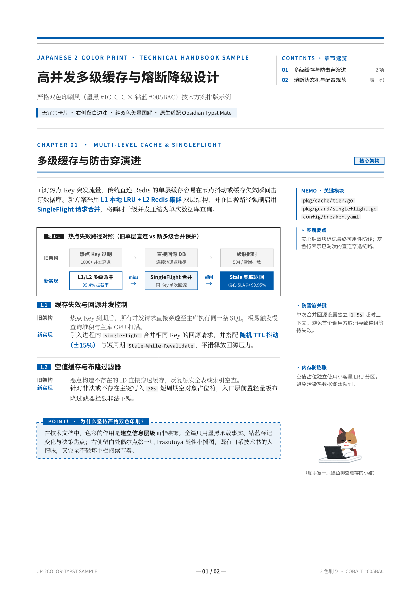
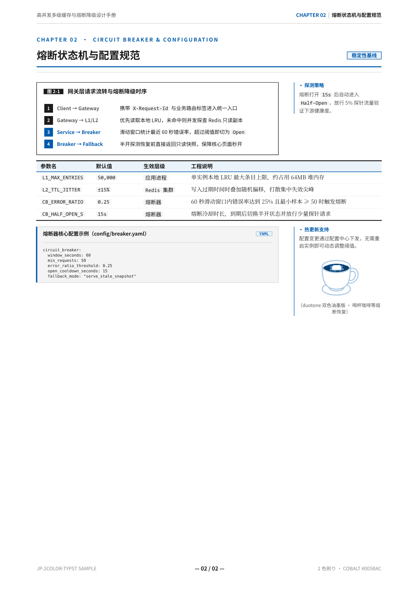

# jp-2color-typst-skill

> **日系双色印刷风（`2色刷り`）技术文档 Typst Agent Skill**
> 灵感源自《图解 HTTP》/ 技术评论社（Gihyo）/ 翔泳社（Shoeisha）经典双色技术书排版，严格使用**墨黑 `#1C1C1C` × 单一专色（默认印刷钴蓝 `#005BAC`）**，无冗余卡片、自带右侧留白边注与纯双色矢量图解，并原生适配 **Obsidian `Typst Mate`** 实时预览。

---

## 效果预览

| 第 1 页：开篇标题头 + 双色矢量对照图 + 边注对比条目 + `POINT!` 框 | 第 2 页：页眉自动跟随章节 + 时序图 + 三线表 + 印刷风代码块 |
| :---: | :---: |
|  |  |

---

## 目录结构

```text
jp-2color-typst-skill/
├── README.md
├── assets/
│   ├── preview-page-1.png
│   └── preview-page-2.png
└── skills/
    └── jp-2color-typst/
        ├── SKILL.md                               # Skill 主指令（Agent 触发条件与完整工作流）
        ├── resources/
        │   └── template-jp-2color.typ             # 通用双色印刷 Typst 模板与全套组件
        ├── references/
        │   ├── components-and-diagrams.md         # 组件 API 与双色矢量图画法速查
        │   ├── illustrations-and-irasutoya.md     # 4 轨配图体系（book_skill 信息图 + Irasutoya 插图）
        │   └── obsidian-typst-mate-guide.md       # Obsidian Typst Mate 预览与字体切片指南
        ├── examples/
        │   ├── sample-tech-spec.typ               # 可直接编译的完整双页示例（含 Irasutoya 原色 & 双色示例）
        │   └── assets/irasutoya/                  # 示例用 Irasutoya 透明 PNG
        └── scripts/
            ├── fetch_irasutoya.py                 # 从 irasutoya.com 一键检索并下载透明 PNG
            ├── process_illustration.py            # 配图后处理（whiten 漂白 / chroma-key 抠透明 / duotone 双色化）
            └── slice_obsidian_fonts.py            # Windows Noto SC 可变字体静态切片脚本
```

---

## 四轨配图体系（借鉴 `book_skill` + 日系技术书 Irasutoya）

| 配图轨道 | 适用场景 | 工具 / 组件 |
| :--- | :--- | :--- |
| **1. 原生 Typst 矢量图** | 3–6 节点对比流、架构框、时序步 | `#jp2-diagram` + `d-box` / `d-arrow` / `seq-step` |
| **2. AI 手绘信息图 / 概念图** | 冰山、漏斗、闸门等视觉隐喻图 | `#jp2-figure-img` + `process_illustration.py whiten / chroma-key` |
| **3. Mermaid 架构图** | 复杂状态机与多子图拓扑（务必输出 PNG，Typst 不支持 Mermaid SVG `<foreignObject>`） | `#jp2-figure-img` |
| **4. Irasutoya (`いらすとや`) 随性插图** | 右栏边注、`POINT!` 框旁“无关紧要但超有日系技术书味道”的可爱小图 | `fetch_irasutoya.py` + `#jp2-margin-mascot` / `#jp2-point-box(mascot: ...)`（支持保留原色或 `duotone` 转双色油墨） |

### 快速拉一张 Irasutoya 小插图
```powershell
# 下载透明 PNG（原色，适合做可爱反差萌点缀）
python skills/jp-2color-typst/scripts/fetch_irasutoya.py get "猫 パソコン" --out ./assets/irasutoya --name cat_pc.png

# 可选：一键转成墨黑 × 钴蓝双色印刷油墨风
uv run --with pillow --with numpy skills/jp-2color-typst/scripts/process_illustration.py duotone ./assets/irasutoya/cat_pc.png ./assets/irasutoya/cat_pc-cobalt.png --spot "#005BAC"
```

---

## 后续你可以怎么优化这个 Skill

1. **调整主指令与写作偏好**：编辑 [skills/jp-2color-typst/SKILL.md](./skills/jp-2color-typst/SKILL.md)，补充你偏好的文档结构、字号密度或校验步骤。
2. **自定义配色与字体**：编辑 [skills/jp-2color-typst/resources/template-jp-2color.typ](./skills/jp-2color-typst/resources/template-jp-2color.typ) 顶部的 `ink` 字典，换一套专色即可整本换肤（模板内已预留朱红 `#C83E2B`、松绿 `#1F6B4E`、蓝黑 `#1E3A5F` 参考值）。
3. **验证修改效果**：直接编译示例文件并预览 PNG：
   ```powershell
   typst compile --format png --ppi 150 skills/jp-2color-typst/examples/sample-tech-spec.typ assets/preview-page-{p}.png
   ```

---

## 优化完成后如何安装

### 1. 安装到 Antigravity（全局生效）
将 `skills/jp-2color-typst` 复制（或软链接）到全局技能目录：
```powershell
Copy-Item -Recurse -Force .\skills\jp-2color-typst "$env:USERPROFILE\.gemini\config\skills\jp-2color-typst"
```

### 2. 仅安装到指定项目 / Obsidian 笔记库
```powershell
Copy-Item -Recurse -Force .\skills\jp-2color-typst "<你的工作区>\.agents\skills\jp-2color-typst"
```

### 3. 通过 `skills` CLI 安装（设为 Public 后可用）
```bash
npx skills add doudousukyi37/jp-2color-typst-skill
```

---

## Obsidian `Typst Mate` 配套字体脚本

如果在 Obsidian `Typst Mate` 中遇到中文乱码或字体过细发淡（可变字体权重塌陷），直接运行内置脚本生成静态 Regular/Bold 字体：

```powershell
uv run --with fonttools skills/jp-2color-typst/scripts/slice_obsidian_fonts.py --vault "<你的 Obsidian 笔记库路径>"
```

详见 [obsidian-typst-mate-guide.md](./skills/jp-2color-typst/references/obsidian-typst-mate-guide.md)。
